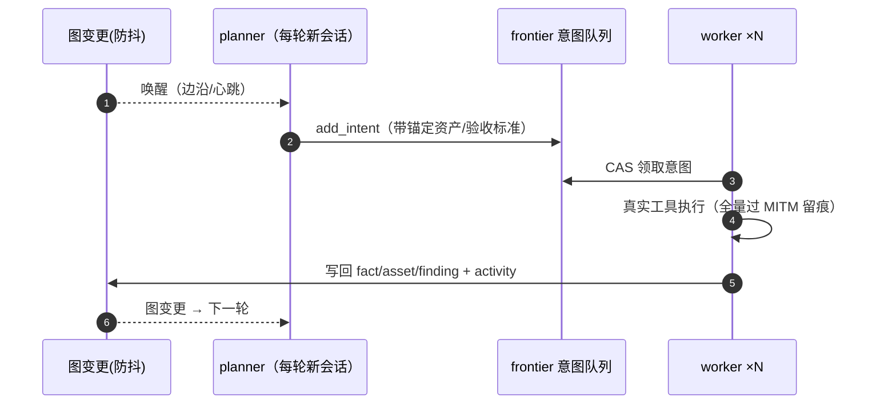

<div align="center">


# 盘古 Pangu

**AI 自主渗透测试平台 · 一句话目标 → 可核验证据 → 可交付报告**

> 盘古开天，先分边界，再定真伪。<br/>
> 不猜漏洞，只证明影响。

[](https://github.com/just805/Pangu/releases)
[](https://github.com/just805/Pangu/actions/workflows/ci.yml)
[](LICENSE)


**Go 单体后端** · **Next.js 内嵌前端** · **PostgreSQL 唯一存储** · **planner/worker 双角色多 Agent** · **双图 + 全程证据留痕**

</div>

---

## 01 · 它解决什么问题

多数「AI 渗透」产品的瓶颈不是会不会调工具，而是**敢不敢对结论负责**：
模型说「完成了」、扫描器说「可能有问题」，交付时却拿不出可复现的证据。

Pangu 用**五道确定性闸门**把这件事焊死：

| 闸门 | 规则 | 效果 |
|---|---|---|
| **目标闸门** | 每个目标必须带可核验的验收标准；全部 `met` 才允许 `goal_met` | 不能靠 LLM 自评收官 |
| **证据闸门** | critical/high 必须有机械证据（请求响应、命令输出、流量对照） | 版本匹配 / 「可能存在」进不了报告 |
| **写回闸门** | `record_fact` / `report_finding` 只能锚定本任务授权范围资产 | 越界写回直接拒绝 |
| **审批闸门** | 10 条硬禁 / 13 条 LLM 研判 / 1 条人工确认 | 破坏性动作三层拦截 |
| **终态闸门** | 目标未全达成时，任何收尾都落 `timeout`（未完成） | 列表/详情/报告口径一致 |

一句话：**它不假装跑完了，也不假装漏洞是真的。**

---

## 02 · 快速开始

> 依赖 **PostgreSQL**；探索需在 UI 配置 **LLM**（Anthropic / OpenAI / 任意兼容网关，多通道轮询）。
> 系统选择、公网部署、升级排障见 [安装详解](#07--部署与配置) 与 [docs/部署手册.md](docs/部署手册.md)。

**Linux（Debian / Ubuntu / RHEL / Kali，root，全自动交互安装）：**

```bash
curl -fsSL https://github.com/just805/Pangu/releases/latest/download/install.sh | sudo bash
```

**macOS 13+（Apple Silicon / Intel，无需 sudo）：**

```bash
curl -fsSL https://github.com/just805/Pangu/releases/latest/download/install.sh | bash
```

**Docker（工具链全在镜像内，宿主机零安装）：**

```bash
git clone --depth 1 https://github.com/just805/Pangu.git pangu && cd pangu
cp .env.example .env      # 至少修改 POSTGRES_PASSWORD
docker compose up -d      # → http://localhost:8787
# Windows: docker compose -f docker-compose.yml -f docker-compose.windows.yml up -d
```

**装好后 3 分钟：**

1. 打开 `http://<host>:8787`，初始化管理员密码（≥8 位）；
2. 「LLM 配置」添加 ≥2 个通道并开启轮询（实战推荐）；
3. 「宿主环境」按需一键装齐工具（Docker 镜像已内置）；
4. 新建任务，给一句话目标与授权范围。

---

## 03 · 界面速览

> 截图来自真实运行实例，目标域名、企业、IP 与漏洞细节均已脱敏。
> 页面按「态势 → 任务 → 发现/资产 → 执行 → 情报 → 平台」组织，与左侧菜单一致。

### 3.1 功能地图

| 模块 | 页面 | 在这里能做什么 |
|---|---|---|
| 态势 | 总览 | 任务、发现、资产、Token 与趋势一屏；按状态/时间筛选任务 |
| 任务 | 任务列表 | 查看目标进度、运行中 Worker、漏洞分布；新建/暂停/归档 |
| 任务 | 任务详情 · 会话 | 多 Agent 对话流、planner 每轮态势、工具调用与结果回放 |
| 任务 | 任务详情 · 总览 | 目标逐条验收标准与达成状态；操作约束 allow/deny |
| 任务 | 任务详情 · 攻击链 | 「初始访问 → 最终影响」链式叙事与 proof point |
| 任务 | 任务详情 · 资产覆盖 | 范围内资产覆盖矩阵、未测资产与缺口提醒 |
| 发现 | 漏洞列表 / 详情 | 跨任务汇总、按严重度筛选、复测、证据 PoC、状态流转 |
| 资产 | 资产台账 / 覆盖图 | 企业 → 根域名/IP/子域/服务/接口；力导向覆盖图 |
| 流量 | 流量查看器 | 全量 HTTP/S 逐请求留存、检索、请求/响应查看 |
| 洞察 | 洞察 / 评测基线 | 跨任务趋势、单位发现成本；成功率/误报率/高危未验证率/时长 |
| 执行 | 对话工作台 / 命令 / 同步 / 工作区 / LLM 记录 | 跨 Agent 对话、命令回放、情报同步、任务目录、模型请求记录 |
| 情报 | 漏洞情报 | CVE / KEV / PoC / 快通道同步与资产指纹匹配 |
| 平台 | 技能库 / MCP / 领域工具 / Agent 角色 | 方法论按需加载、外部能力接入、工具开关、角色模型与可见性 |
| 平台 | LLM 配置 / 宿主环境 / 监听器 C2 | 多通道轮询与熔断、94 件工具体检、回连接收与出口管理 |
| 平台 | 拦截规则 / 审批 / 资产规则 / 代理池 | 三层闸门、待审批动作、资产级规则、多上游轮换 |
| 平台 | 通知 / 日志 / 系统设置 | 漏洞推送、运行与审计日志、预算/隐藏服务/收尾等全局开关 |

### 3.2 截图

**入口与态势**

| 首次启动初始化管理员，防爆破锁定 | 总览：任务 / 发现 / 资产 / Token 趋势 |
| :---: | :---: |
|  |  |

**任务与目标**

| 任务列表：进度与漏洞分布 | 任务详情：多 Agent 会话与规划态势 |
| :---: | :---: |
|  |  |


### 3.3 近期新增页面（按菜单直达）

| 页面 | 看什么 |
|---|---|
| 洞察 → 评测基线 | 任务成功率、漏洞误报率、高危未验证率、平均 Token 与时长 |
| 任务详情 → 攻击链 | finding 血缘投影成链，每步带 proof point |
| 拦截规则 / 审批 | 10 硬禁 / 13 研判 / 1 人工；待审批动作一键处理 |
| 资产规则 / 代理池 | 资产级拦截规则；多上游轮换、健康检查、按 host 选择 |
| 通知 / 日志 | 钉钉/飞书/企业微信推送；运行日志与审计 |
| 命令 / 同步 / 工作区 / LLM 记录 | 命令回放、情报同步、任务目录、模型请求与 Token 计量 |

---

## 04 · 核心机制

### 4.1 双角色多 Agent 闭环



- **planner** 是唯一意图生成者，维护跨唤醒 todolist，串行利用链不漏派、不错序；
- **worker** 完成一条意图即停，写回双图后自动唤醒 planner；
- **mainagent** 接管对话、报告补写与即时任务；
- **人在环路**：对话纠偏、暂停/取消、审批、`steer_work` 实时纠偏。

### 4.2 双图：资产真值 × 探索血缘

- **资产图**（全局共享）：`root_domain / subdomain / ip / service / app / endpoint`，跨任务复用；
- **探索图**（每任务）：`goal → intent → fact / finding`，五类边构成血缘；
- 报告里每条结论都能回溯到「哪条线索、哪次请求、哪段流量」。

### 4.3 执行面：原生执行 + 会话复用 + 后台作业

| 能力 | 说明 |
|---|---|
| `http_request` | 原生 HTTP：方法/头/体/重定向/超时可控，自动过 MITM |
| `session_login` | 五形态登录，任务级 cookie jar 与 curl 互通 |
| 会话复用 | `http_request(session=同名)` 自动带登录态，双身份越权零成本 |
| `poc_scaffold` | 按类别生成可运行验证骨架 |
| `job_*` / `save_script` / `run_script` | 后台长扫描与任务级脚本复用 |
| `miniprogram_unpack` / `miniprogram_audit` | 微信小程序 wxapkg 解包与接口/密钥/云开发审计 |

### 4.4 智能与自愈（v0.1.x 新增）

| 机制 | 作用 |
|---|---|
| **工具可见性上限** | 默认只让 30 个工具 schema 进 prompt，其余走 DeferredTools |
| **高错误率工具标注** | worker 开工前看到本任务反复失败的工具，换手段而非重试 |
| **意图级 / 任务级预算** | 意图 token 软提醒 + 2× 硬闸；任务预算达阈值收敛、达上限收尾 |
| **价值评分截断** | 态势优先保留高价值事实/有产出意图，再按最新补足 |
| **终态 reflection** | 同维度历史收场注入 planner/worker，避免原样重跑 |
| **评测基线** | 成功率 / 误报率 / 高危未验证率 / 成本 / 时长，可固定标定集对比 |

### 4.5 情报与模型路由

- NVD 全量/增量 + CISA KEV + GHSA + PoC 聚合，**近期高危快通道**每 30 分钟；
- 资产指纹反向匹配 CVE，命中即挂 hint；
- 多通道轮询 + 熔断 + 故障转移；planner 强推理 / worker 中推理 / judge 便宜档。

### 4.6 隐藏服务与场景专项

- **Tor / I2P**：`.onion → Tor`、`.i2p → I2P` 按后缀自动路由，超时/重试可配；
- **微信小程序**：取包/解包/抓包/登录态/云开发/开放能力/43 类漏洞/专项报告；
- **攻击链**：finding 血缘投影为「初始访问 → 最终影响」叙事，报告与前端同源。

---

## 05 · 内置资产

### 5.1 24 个内置技能（按场景自动路由）

| 领域 | 技能 |
|---|---|
| 综合方法论 | `vuln-hunting`、`attack-surface-recon`、`pentest-verification`、`pentest-output-standards`、`src-acceptance` |
| Web / API | `web-attack-methods`、`api-security-testing`、`api-recon` |
| 场景专项 | `wechat-miniprogram`、`ai-llm-app-attack`、`cloud-attack-methods`、`active-directory-attack`、`smart-contract-audit`、`wireless-hardware-attack`、`zero-day-research` |
| 客户端 / 逆向 | `binary-mobile-reversing`、`apk-reverse`、`source-code-hunting` |
| 红队 | `redteam-ops`、`redteam-opsec` |
| 资产 / 情报 | `component-vuln-intel`、`scopesentry` |
| 浏览器 / 知识库 | `playwright-cli`、`src-hunting` |

### 5.2 10 个 MCP 预设

FOFA 资产测绘 / Playwright 浏览器 / Chrome DevTools / Burp Suite / Fetch 网页抓取 /
Sequential Thinking / Memory 知识库 / Filesystem / HexStrike 工具桥 / Context7 文档检索。

### 5.3 94 件宿主工具

网络与主机、子域与 DNS、Web 与 API、注入与利用、后渗透、语料与模板六大类；
「宿主环境」页体检 + 一键装齐（特权助手串行排队），缺失工具如实显示。

### 5.4 24 条内置拦截规则

**10 条明令禁止**（不调模型直接拒）/ **13 条交 Agent 研判**（看完整参数裁决）/
**1 条人工确认**（平台能力边界变更）。

---

## 06 · 架构与目录

```text
cmd/            入口（pangu 主服务 / pangu-hostd 特权助手 / pangu-maint）
agent/          多 Agent：planner / worker / mainagent / 领域工具 tools_*.go
db/             PostgreSQL 唯一存储：schema.sql 幂等迁移 + 各表 Store
server/         HTTP 路由 / 引擎调度 / Manager / 会话 / 报告 / 更新
intercept/      拦截引擎：规则 → LLM 研判 → allow/ask/deny
guard/          工具调用审批门
listener/       回连接收器
traffic/        MITM 流量记录 + 出口代理池 + 隐藏服务上游
vulnintel/      NVD/KEV/GHSA/PoC/快通道/资产联动
proxyprobe/     代理校验与隐藏服务路由（Tor/I2P）
hosttools/      94 件宿主工具目录
hostd/          特权助手（root unix socket）
llmpool/        LLM 多通道轮询：熔断/故障转移
llmrec/         LLM 请求录制与 token 计量
report/         报告生成（手写 OOXML 零依赖）
notify/         钉钉/飞书/企业微信等推送
evidence/       证据留存与版本化
enrich/         资产自动补全（DNS/HTTP）
selfupdate/     一键自更新
skills/         24 个内置技能
web/            Next.js 前端（静态导出后 go:embed）
docs/           设计文档 / 部署手册 / 能力对照
```

---

## 07 · 部署与配置

### 7.1 系统支持

| 系统 | 结论 |
|---|---|
| Debian 12 / Ubuntu 22.04 / 24.04 | ✅ 首选（systemd + 系统 PostgreSQL） |
**硬件**：最低 2 核 4G / 20G；推荐 8 核 16G / 60G（含字典、模板、Playwright、LibreOffice）。

### 7.2 配置速查

```json
// config.json（或 PANGU_PG_DSN）
{ "database": { "host": "127.0.0.1", "port": 5432, "user": "pangu",
                "password": "…", "dbname": "pangu", "sslmode": "disable" } }
```

- **LLM**：UI「LLM 配置」多通道 + 轮询；`ANTHROPIC_API_KEY` / `OPENAI_API_KEY` 可兜底；
- **C2 出口**：`PUT /api/c2/config`，`mode=direct|ssh|manual`；
- **隐藏服务**：系统设置「Tor / I2P」；Tor 默认 `socks5h://127.0.0.1:9050`，I2P 默认 `http://127.0.0.1:4444`；
- **反向代理**：前后端同源，Nginx 必须关缓冲（SSE）：

```nginx
location / {
    proxy_pass http://127.0.0.1:8787;
    proxy_set_header Host $host;
    proxy_set_header X-Forwarded-Proto $scheme;
    proxy_set_header X-Forwarded-For $proxy_add_x_forwarded_for;
    proxy_buffering off; proxy_read_timeout 3600s;
    proxy_http_version 1.1; proxy_set_header Connection "";
}
```

### 7.3 升级与备份

- 页面一键更新：下载 → SHA256 → 冒烟 → 原子换装 → 失败回滚；只换程序不动数据；
- Docker：`docker compose pull && docker compose up -d`；
- 数据备份：Linux/macOS 的 compose 把数据绑定在项目根 `./data`，直接
  `tar czf pangu-data.tgz -C ./data .`；Windows compose 使用 named volume
  `pangu-data`（实际名称带 Compose 项目前缀，以 `docker volume ls` 为准），
  可用 `docker run --rm -v <实际卷名>:/data -v "%cd%:/backup" alpine tar czf /backup/pangu-data.tgz -C /data .`。

---

## 08 · 与同类项目的差异

| 维度 | 常见同类 | Pangu |
|---|---|---|
| 完成判定 | LLM 自评「完成」 | 目标 + 验收标准 + `goal_met` 闸门，未达成强制未完成 |
| 漏洞可信度 | 扫描器输出直接入库 | 机械证据闸门 + L1–L4 分级 + 对抗式自检 |
| 重复漏洞 | 标题/URL 简单去重 | 多键去重 + 合并时间线 + 跨任务去重 |
| 深度利用 | 确认漏洞即结束 | 攻击链续跳，L1→L4 推进纪律 |
| 长任务 | 单轮超时即丢 | 后台作业 + 共享脚本 + 会话复用 |
| 流量证据 | 无或截图 | MITM 逐请求留存 + 四类证据 + sha256 + 报告引用 |
| 情报 | 静态知识库 | 时间流 + KEV + 指纹反向匹配 + 快通道 |
| 交付 | Markdown | 公文级 Word + 覆盖度/攻击路径 + 一漏洞一 docx |
| 成本 | 单通道 | 多通道轮询 + 熔断 + 角色路由 + 预算闸门 |

---

## 09 · 纪律与边界

- **授权优先**：任务创建即声明范围，资产图按范围登记，写回守卫数据层拦截越界；
- **最小伤害**：SQL 探测默认只读；上传只验证能力不落地后门；登录面 ≤5 组失败即停；
- **审批门**：破坏性命令三层闸门，平台能力边界变更转人工；
- **凭据卫生**：LLM key / FOFA key 只进运行时配置，不入仓库、不入报告；
- **复测手动**：平台不自动触发任何复测动作。

---

## 10 · 开发 / 文档 / 来源 / 许可

### 开发

```bash
./dev.sh                          # 后端 :8787 + 流量代理 :8788 + 前端 :5173
go build ./...                    # 后端构建
go test -p 1 ./... -count=1       # 全量测试（需 PG；-p 1 防跨包死锁）
cd web && npx tsc --noEmit && NEXT_EXPORT=1 npx next build
```

- 后端：`go run ./cmd/pangu`（`-tags embedui` 内嵌前端）
- 前端：`cd web && npm run dev`（`/api` 反代热更新）
- Mock 预览：`cd web && NEXT_PUBLIC_MOCK=1 npm run dev`

### 文档索引

| 文档 | 内容 |
|---|---|
| [docs/项目交接文档.md](docs/项目交接文档.md) | 接手背景与目录地图 |
| [docs/01-双图架构.md](docs/01-双图架构.md) | 资产图/探索图与不变量 |
| [docs/02-引擎与调度闭环.md](docs/02-引擎与调度闭环.md) | planner/worker 编排与生命周期 |
| [docs/03-LLM接入层.md](docs/03-LLM接入层.md) | 选路、轮询、熔断、计量 |
| [docs/04-审批与拦截.md](docs/04-审批与拦截.md) | 三层规则与裁决链路 |
| [docs/部署手册.md](docs/部署手册.md) | 部署 / 升级 / 排障 / Tor-I2P |
| [docs/深度优化方案-2026-10-31.md](docs/深度优化方案-2026-10-31.md) | 当前路线图与认知架构 |
| [docs/产品全面体检-2026-10-31.md](docs/产品全面体检-2026-10-31.md) | 缺陷基线 |
| [docs/同行对比分析-2026-11.md](docs/同行对比分析-2026-11.md) | 同行调研与借鉴清单 |
| [CHANGELOG.md](CHANGELOG.md) | 逐版本更新记录 |

### 来源声明

本项目接手自原作者已删除仓库的最终定版（v0.3.15），原作者代码保留在 git 历史中作为起点。

- **保留**：双图架构、planner/worker 编排、MITM 流量代理、审批门框架、基础工具集；
- **重建**：设计文档、CI 门禁、依赖解耦、Docker 源、技能体系；
- **独立演进**：v0.1.x 起由本仓库维护者持续演进，覆盖情报运营、目标闸门、攻击链、
  执行面、去重合并、证据链、评测基线、隐藏服务与小程序专项等能力线。

### 许可与免责

**AGPL-3.0**，完整条款见 [LICENSE](LICENSE)。

**本工具仅供个人学习、代码研究与本地隔离环境验证，不得用于对任何线上系统发起实际测试。**
使用者须自行遵守所在国家/地区法律法规；因使用产生的一切法律责任由使用者自行承担。
本项目按「现状」提供，不附带任何担保。

---

<div align="center">

**盘古 · Pangu** — 不猜漏洞，只证明影响。

</div>
